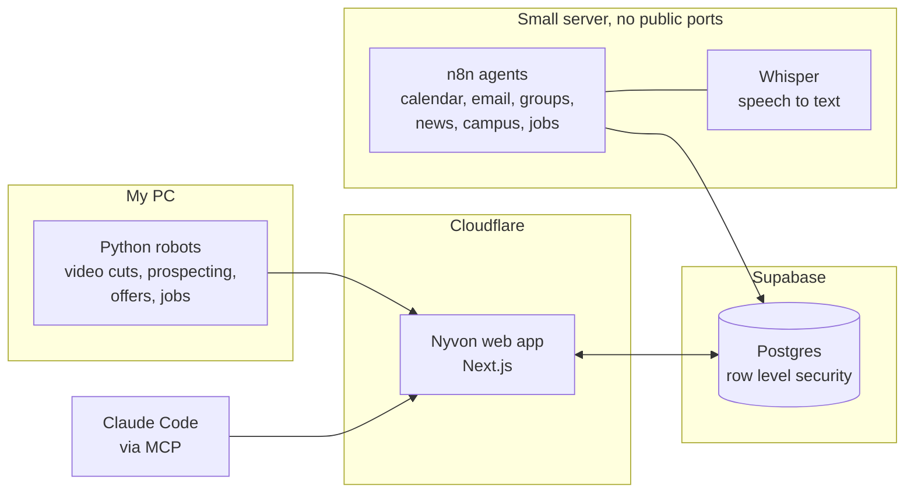

# Nyvon

My personal and work assistant. One web app that I open in the morning, plus small AI agents that work for me during the day and night.
It started on **October 23, 2026** as a local Python chat. Until November 19 it was called "Jarvis".

## The problem

My day is split between clients (marketing), my Master's in AI, job search and my own projects.
The information is in many places: calendar, Gmail, WhatsApp groups, the Master's campus, ad accounts.
I wanted **one screen** that tells me what matters today, with a source for every line, and agents that never act without my "yes".

## How it works

- **App:** Next.js on a Cloudflare Worker, database on Supabase (Postgres with row level security). About 17 screens: Today, Diary, Talk to Nyvon, CRM funnel, Execution, Clients, Finance, Meta Ads, Master's, Jobs, Prospecting, Low Ticket, Video cuts, Costs and server, Settings.
- **Agents:** n8n workflows on a small VPS (≈ 26 €/month). The server has **no open port to the internet**; I reach it only through a private network (Tailscale).
- **Robots on my PC:** Python scripts for heavy work (video, scraping). The app only saves a request; the robot on my PC picks it up.
- **AI:** Claude models with a fixed JSON output, and Whisper running on the server (audio never leaves it).
- **Claude Code** can read and update the app through an MCP server.

## Rules I set (and the code enforces)

1. **No source, no entry.** The database itself refuses a Diary entry without a source, even if the code has a bug.
2. **My "yes" before any action.** Calendar events, emails to the campus, everything that changes something waits for a button.
3. **Read-only by default.** Gmail, WhatsApp groups and ad accounts are read with read-only access.
4. **Costs with a ceiling.** 100 US$/month for AI, a daily cap per agent, and a screen that shows the spend.
5. **No secrets in the package.** The deploy stops if it finds a secret inside the app bundle.

## Timeline

| Date | Milestone |
|---|---|
| Oct 23 | Local chat in Python, cost of every answer on screen, memory in SQLite |
| Oct 24 | Read-only tools, actions only after a click, first voice conversation |
| Oct 30 | My own CRM to replace ClickUp |
| Nov 1 | Server, Diary with sources, calendar agent, WhatsApp groups summary, "Good morning" at 8 am |
| Nov 2–4 | Email agent, "try again" button, costs panel, Master's tutor, news agent, offer miner |
| Nov 10 | Version 2.0: Today screen, mobile layout, security fixes |
| Nov 12–19 | Prospecting, job robot, video cuts on my PC, safety filter |
| Nov 19 | New name: Nyvon |

Each step has a post in the [build log](../devlog.md).

## What the AI did and what I decided

Claude Code wrote most of the code and the tests and found most of the bugs.
I decided what the assistant does and in which order, the rules above, the budget, what each agent may read, and I test every screen in my daily use.

## Status

In daily use. The code is private (it holds my clients' data).
